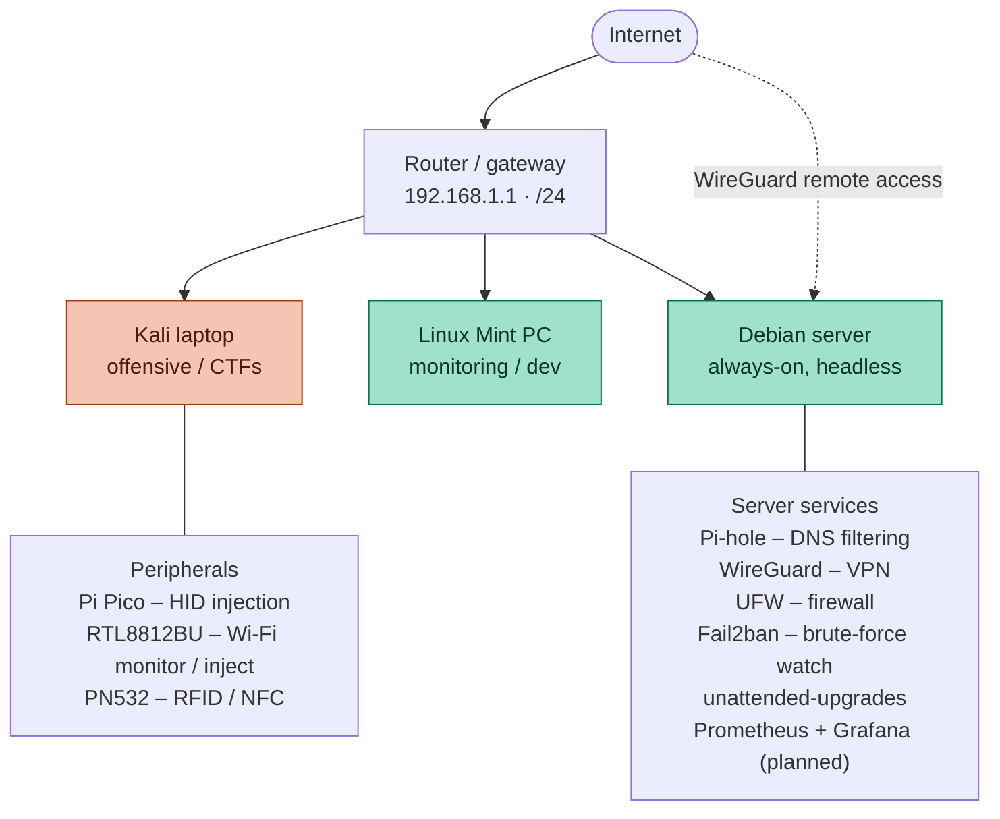

# Home Lab & Network Overview

A look at the physical and virtual setup I use for hands-on offensive and defensive security practice.

## Network diagram

*Offensive (coral) vs defensive / infrastructure (teal). Note: the Debian server's CPU predates SSE4.2, which rules out Suricata and DPDK — see below.*

## Devices

| Device | OS | Role |
|---|---|---|
| Acer laptop (`kali-laptop`) | Kali Linux | Primary offensive box, CTFs, pentesting tools, exploit dev |
| PC (`zz`) | Linux Mint | Passive monitoring, general development, secondary workstation |
| Dell Latitude | Debian | Home server, network services, defensive hardening practice |

## Home Server (Debian)

The Dell Latitude runs headless as a always-on home server, hosting the following stack:

- **Pi-hole** — network-wide DNS ad/tracker blocking (scoped to my own devices)
- **WireGuard VPN** (via PiVPN) — remote access into the home network
- **UFW** — firewall rules restricting inbound access to only what's needed
- **Fail2ban** — with custom jails tuned beyond the defaults, watching for brute-force and abuse patterns
- **Unattended upgrades** — automatic security patching so the box doesn't drift out of date

### Hardware constraint

The Dell's CPU predates SSE4.2 support, which rules out running certain tools that hard-depend on it, notably **Suricata** and **DPDK**. Worth documenting since it shaped several tooling decisions and is a useful reminder that lab hardware limits are real limits, not just inconvenience.

### Planned additions

- **Prometheus + Grafana** monitoring stack, with `node_exporter` and a Pi-hole exporter, for actual visibility into server health and DNS query stats over time

## Other Hardware

- **Raspberry Pi Pico** — Bad USB / HID injection project, running CircuitPython with Adafruit's HID library
- **RTL8812BU USB WiFi adapter** — supports monitor mode and packet injection for wireless work
- **PN532 RFID module** — RFID/NFC reading and experimentation

## Why This Setup

Running my own multi-machine lab means I'm not just completing rooms in isolation, I'm also maintaining real infrastructure: patching it, hardening it, monitoring it, and dealing with the same constraints (old hardware, config quirks, actual uptime) that come with running anything long-term. It's as much a defensive security exercise as the offensive side is.
